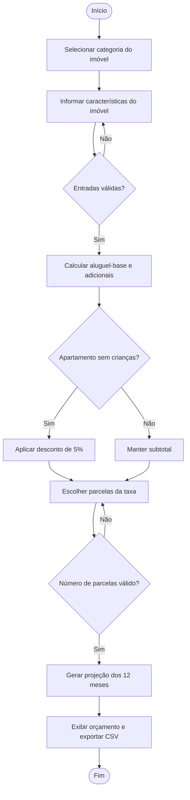

# RentSmart — Relatório teórico

**Disciplina:** Algorithmic Thinking & Introduction to Object-Oriented Programming  
**Estudante:** Arthur  
**Instituição:** UniFECAF  
**Curso:** Ciência da Computação

## 1. Problema e regras de negócio

A imobiliária fictícia R.M Imóveis necessita automatizar orçamentos de locação de casas, apartamentos e estúdios. O programa RentSmart recebe as características do imóvel, aplica regras comerciais e fornece um resumo transparente, além de uma projeção dos pagamentos do primeiro ano.

| Regra | Valor |
| --- | ---: |
| Apartamento de 1 quarto | R$ 700,00 por mês |
| Apartamento de 2 quartos | + R$ 200,00 por mês |
| Casa de 1 quarto | R$ 900,00 por mês |
| Casa de 2 quartos | + R$ 250,00 por mês |
| Estúdio | R$ 1.200,00 por mês |
| Garagem de casa/apartamento | + R$ 300,00 por mês |
| Pacote de 2 vagas para estúdio | + R$ 250,00 por mês |
| Vaga adicional de estúdio além das duas iniciais | + R$ 60,00 por vaga/mês |
| Apartamento sem crianças | Desconto de 5% após os adicionais |
| Taxa contratual | R$ 2.000,00 em até cinco parcelas |

**Premissas:** O estacionamento de estúdio pode não ser contratado ou utilizar o pacote de duas ou mais vagas, já que o preço de uma única vaga não consta do enunciado. A taxa contratual é separada do aluguel e distribuída pelos primeiros meses. Não se consideram reajustes, condomínio ou despesas não especificadas.

## 2. Entradas, processamentos e saídas

**Entradas:** tipo de imóvel; número de quartos, quando aplicável; existência de garagem ou quantidade de vagas; presença de crianças para apartamentos; número de parcelas da taxa contratual.

**Processamento:** validação de entradas, determinação do aluguel-base, aplicação dos adicionais, desconto somente a apartamentos sem crianças, cálculo das parcelas e projeção dos 12 meses.

**Saídas:** orçamento discriminado no terminal, tabela de pagamentos e arquivo CSV contendo doze registros mensais.

## 3. Fluxograma do processo

## 4. Arquitetura orientada a objetos

A classe abstrata **Imovel** define a interface comum de cálculo: `descricao`, `detalhamento()` e `aluguel_mensal`.

As classes **Apartamento**, **Casa** e **Estudio** herdam de `Imovel` e implementam `detalhamento()` segundo suas regras comerciais específicas. Em `Apartamento`, os atributos são `quartos`, `garagem` e `possui_criancas`; em `Casa`, `quartos` e `garagem`; e em `Estudio`, `vagas`.

A classe **Orcamento** recebe um objeto da família `Imovel` e o número de `parcelas_taxa`, calculando o custo mensal, as parcelas da taxa e os valores de todo o primeiro ano com `parcela_da_taxa()`, `projecao()` e `total_primeiro_ano`.

A classe **ExportadorCSV** possui o método `exportar()`, que grava os dados financeiros em CSV.

Essa organização implementa **abstração, herança, polimorfismo e composição**, separando regras de negócio, interação com o usuário e persistência dos dados.

## 5. Algoritmo, cálculos e exemplo

O programa executa a sequência: solicitar e validar os dados; escolher o imóvel e somar os adicionais; aplicar o desconto apropriado; calcular as parcelas da taxa contratual; produzir a tabela de doze meses; exibir os resultados e exportar o CSV.

Em uma simulação com **apartamento de dois quartos, garagem e sem crianças**, o subtotal é R$ 700,00 + R$ 200,00 + R$ 300,00 = R$ 1.200,00. O desconto de 5% é R$ 60,00, gerando aluguel mensal de **R$ 1.140,00**.

A taxa contratual de R$ 2.000,00, parcelada em cinco vezes, representa R$ 400,00 em cada um dos primeiros cinco meses. Desse modo, os meses 1 a 5 totalizam R$ 1.540,00 cada, e os meses 6 a 12 totalizam R$ 1.140,00 cada. O **total anual é R$ 15.680,00**.

Quando uma divisão não produz parcelas idênticas em centavos, o restante é distribuído entre as primeiras parcelas (três parcelas: R$ 666,67, R$ 666,67, R$ 666,66).

## 6. Validação, testes e conclusão

O código valida os tipos de imóvel, quantidades permitidas de quartos e vagas, respostas sim/não e de uma a cinco parcelas. Além disso, as classes rejeitam valores incompatíveis mesmo quando utilizadas fora da interface de terminal.

O módulo `testes/test_rentsmart.py` contém **13 testes automatizados** com preços-base, adicionais, descontos, entradas inválidas, parcelamento, projeção anual e geração do CSV.

O pensamento algorítmico permitiu decompor as regras em etapas consistentes de entrada, decisão, processamento e saída. A programação orientada a objetos permite reutilização de uma interface comum, separação de responsabilidades e facilidade de manutenção.

**Referências:** Enunciado `TRABALHO - AT & IOOP.docx`, páginas 1–5; Documentação oficial do Python, https://docs.python.org/pt-br/3/.  
**Arquivos correspondentes:** `main.py`, `modelos.py`, `exportacao.py` e `testes/test_rentsmart.py`.
